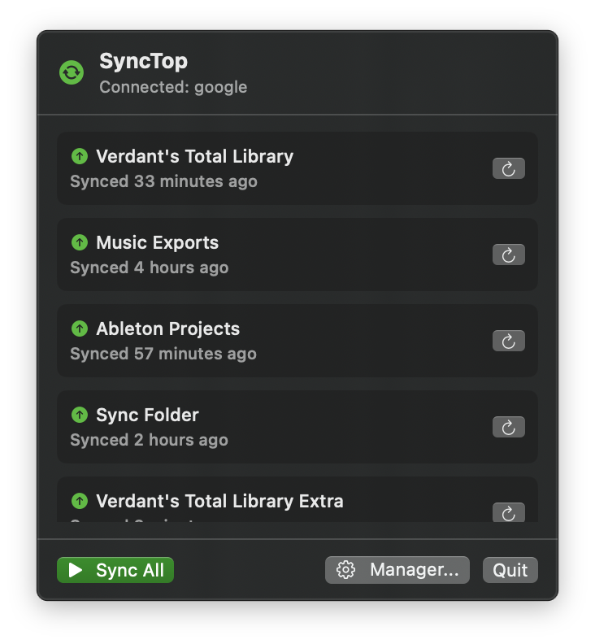

# SyncTop

SyncTop is a lightweight macOS menu bar app for syncing local folders with Google Drive without mounting virtual drives.

It uses [rclone](https://rclone.org) under the hood to transfer files directly via the Google Drive API, keeping your local folders as normal, high-speed directories.



## Features

- **Mount-free**: Talks directly to Google Drive over HTTPS. No virtual drive mounts or file-locking issues.
- **Two-way sync & one-way backup**:
  - Two-way (`bisync`) with conflict copy protection (`.sync-conflict` files).
  - Push (Local → Cloud backup).
  - Pull (Cloud → Local restore).
- **Menu bar utility**: Runs quietly in the menu bar with zero Dock clutter.
- **Remote folder browser**: Browse and create folders directly in Google Drive from the app.
- **Ignore presets**:
  - Developer preset (`node_modules`, `.git`, `.venv`, `target`, `build`, `dist`, etc.).
  - macOS system preset (`.DS_Store`, `.Trash`, `Thumbs.db`).
  - Custom comma-separated exclusion rules.
- **Dry-run simulation**: Preview what files will be copied or deleted before syncing.
- **Automatic scheduling**: Set sync intervals per folder (5m, 15m, 30m, 1h, 4h, 12h, Daily, Weekly) with a live countdown.
- **Start at Login**: Optional setting to launch automatically at macOS boot.
- **Sleep prevention**: Prevents your Mac from sleeping while a transfer is active.

## Prerequisites

SyncTop requires `rclone` installed and configured with your Google Drive account.

1. Install rclone:
   ```bash
   brew install rclone
   ```

2. Configure your Google Drive remote (name it `google`):
   ```bash
   rclone config
   ```
   Follow the prompts to add a new remote of type `drive` and name it `google`.

## Installation

Download `SyncTop.zip` from the [Releases](https://github.com/berikai/SyncTop/releases) page, unzip it, and move `SyncTop.app` to your `/Applications` folder.

> **Note**: On first launch, right-click `SyncTop.app` and choose **Open** to approve macOS Gatekeeper.

## Building from Source

Requirements: macOS 14.0+, Xcode Command Line Tools.

```bash
git clone https://github.com/berikai/SyncTop.git
cd SyncTop

# Build the app bundle
./scripts/build_app.sh

# Run the app
open dist/SyncTop.app
```

Run tests:
```bash
swift run SyncTopTests
```

## How It Works

1. Click the SyncTop icon in the menu bar and select **Manager...**.
2. Click **Add Folder Pair**.
3. Select your local folder and choose or create a destination folder in Google Drive using the **Browse...** button.
4. Choose your sync direction (Two-Way, Push, or Pull).
5. (Optional) Set an automatic sync interval or toggle ignore presets.
6. Click **Sync Now** or **Sync All** from the menu bar anytime.

## Configuration Files

Settings and sync history are stored locally in standard JSON format:
- `~/Library/Application Support/SyncTop/profiles.json`
- `~/Library/Application Support/SyncTop/history.json`

## License

[MIT](LICENSE)
